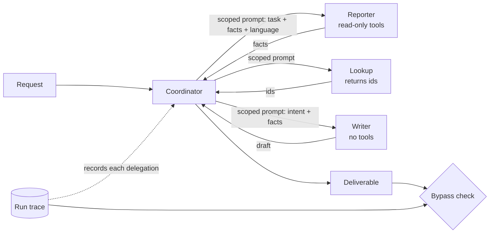

# Coordinator and Specialists

How to build an agent team with one coordinator that routes work and several specialists that each do one thing, when the specialists hold different tools or permissions. The [Dispatch & Coordinate](../../skills/orchestration/dispatch-coordinate.md) skill gives every sub-agent the same shared task context, which suits specialists that work on one body of material, such as a video coordinator's SEO and thumbnail agents. When one specialist may only read, another may only write, and a third may touch contact data, a shared context lets each of them act on the others' parts of the request. This document describes a variant for that case: each delegation carries a scoped prompt instead of the shared context. It explains the rules and the failure each one prevents.

## Overview

- **The coordinator** receives the request, decides who does what, writes one prompt per specialist, and assembles the answer. It holds no data of its own and does not write the deliverable.
- **Specialists** each have a narrow role and only the tools that role needs: a read-only reporter that queries one system, a writer with no tools at all, a lookup agent that returns identifiers and not contact details.
- **Code around the run** checks what the run did: which specialists were called, and whether the deliverable came from the one that should have written it.

## 1. Scope the context of each delegation

Many agent frameworks forward the coordinator's conversation to a sub-agent by default, with the coordinator's prompt added on top. Every specialist then sees the whole request, not only its part.

The failure is concrete. A read-only reporter, asked only to list the events in a date range, also received the request it was part of: "find next week's events and write a confirmation email to every venue contact". It drafted the emails. Nothing in its own instructions asked it to; the instruction was in its context, so it followed it.

The fix is to forward no parent messages and to make the coordinator's prompt self-contained:

- The specialist's task, stated for it alone.
- The facts that task needs. A reporter gets the date range; a writer gets the intent and the facts to convey.
- The language to write in (see §2).

A specialist's own instructions can also say what it must never do ("report data only; never draft messages"), but that is a second line of defence. A role boundary that depends on the model ignoring an instruction in front of it does not hold.

## 2. State the output language in every delegation

With scoped context, the coordinator is the only agent that sees the request as its author wrote it. A specialist cannot tell what language the request was in, so it cannot follow a rule like "reply in the user's language". Carrying the language into each delegation is therefore the coordinator's job:

- Every dispatch whose output is meant for a reader names the language.
- A specialist that is not told falls back to one fixed default, stated in its own instructions. It does not guess from the subject matter: a foreign place name inside a request is not a request for that language.
- The language of the deliverable and the language of the coordinator's reply are separate decisions. A request written in one language for a message in another gets a reply in the first and a message in the second.

## 3. Give writers facts, not drafts, and no tools

A writer with no tools cannot look anything up, so every fact in its output was handed to it by the coordinator. A missing fact then appears as a gap rather than as an invention, and a gap is the intended failure for anything published under the organisation's name.

This only holds if the coordinator does not pre-write the text. A coordinator that writes the body itself and asks the writer to polish it has moved the writing, and any invented fact, back into the agent with the widest context.

When several deliverables rest on the same facts (one post per channel, one message per audience), request them in a single run. The facts are fetched once and every version states the same ones. Asking once per deliverable repeats the lookups and can return versions that disagree. The writer is still asked separately for each deliverable, with that deliverable's own rules, because one draft copied to every destination is a failure of its own.

## 4. Generate the catalogue from the enabled set

The coordinator's prompt describes each specialist: what it can do, what it must not be asked, and when to hand it work. If agents can be switched off per deployment, a hand-written catalogue goes stale the moment one is. A coordinator that advertises a capability it cannot route to is worse than one that says nothing, because it improvises the missing step.

- Keep each specialist's description next to its definition, and build both the coordinator's catalogue and its routing map from the same enabled list. The prompt and the map cannot then disagree.
- Guidance that spans several specialists (a multi-step chain such as look up → draft → submit for approval) names the specialists it needs, and is dropped whole when any of them is off. Rewriting it with a step missing reads as an instruction to improvise that step.
- An empty crew is stated in the prompt: nobody is available, so say so instead of attempting the work.
- A test checks that the list of agent identifiers matches the agent definitions on disk, so a new agent cannot be added without becoming switchable.

## 5. Make delegation observable, and check for bypass

A coordinator that answers without delegating is the failure that looks most like success. The draft is fluent and on topic, and any fact the coordinator did not hold may be invented. Nothing downstream catches it unless the run records who was asked.

- **Record every delegation in a run trace.** Many frameworks expose a delegation as a tool call, so a per-step hook that collects tool-call names in order is enough.
- **Check the trace after the run.** Code that asked for public copy checks that the writer was called. When it was not, it logs a policy event with the actual delegation list and raises an alarm. The draft is not thrown away (it may be usable) but a person sees it flagged.
- **Normalise names in one place.** A framework may record a delegation under a prefixed name (for example `agent-<name>`) while callers ask for the bare name. A comparison that never matches turns the bypass check into a warning that fires on every run, and a warning that is always on catches nothing.
- **Keep recording separate from logging.** The trace is read by checks as well as by people. A setting that silences trace output must not stop the trace from recording, or every check reports that nobody was delegated to.
- **Check sources as well as presence.** When a deliverable's facts must come from the brief alone (for example, content for a tenant whose data the reporter must not touch), calling the reporter is itself the violation, and the run is refused.

## Testing

All of these can be tested without a model call:

| Rule | Test |
|---|---|
| Scoped context | The coordinator's delegation settings forward no parent messages. |
| Language | The coordinator's instructions include the language rule whenever any specialist is enabled. |
| Generated catalogue | For each combination of enabled agents, the catalogue lists exactly those agents, and each cross-agent section appears only when all its members are enabled. |
| Agent list drift | The agent identifiers match the agent definitions on disk. |
| Bypass check | A recorded trace without the writer raises the alarm; a trace with it, under either name form, does not; silencing trace output leaves the check working. |

## Related

- [Dispatch & Coordinate skill](../../skills/orchestration/dispatch-coordinate.md): the shared-context procedure this document is a variant of.
- [Video Content Manager](../../agents/marketing/video-content-manager.md): a coordinator whose sub-agents share one Project Context.
- [Issue-Coding Loop](issue-coding-loop.md): a coordinator whose dispatches are coding and review runs.
- [Capability Configuration That Only Subtracts](capability-configuration.md): the enabled set that the catalogue in §4 is generated from.
