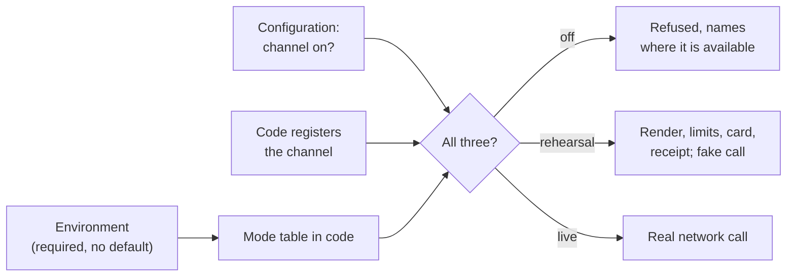

# Environment Modes

How to run the same agent in development and in production without either one acting as the other. The two usually share a repository, a configuration file and often the same credentials. Unless something explicitly separates them, a developer machine can answer production's chat traffic, write to production's database, or publish to a real audience. A production deployment can also quietly rehearse something that should have happened for real. This document describes a mode per outbound channel, chosen by the environment from a reviewed table, and the startup checks that keep each environment in its own lane.

## Overview

- **The environment is named explicitly**, by a variable the project owns, with no default.
- **Each outbound channel has a mode per environment**: `live`, `rehearsal` or `off`, read from a table in code.
- **A channel graduates.** It is usable in development until it is proven, and in production afterwards. Tests assert the table's shape.
- **A rehearsal runs everything except the network call**, and its receipt cannot be mistaken for a real one.
- **The mode is stamped on the approval** and re-checked when a person approves.
- **Startup checks refuse a mismatched environment**: the wrong database, the wrong mail host, the wrong bot identity, or production without its deployed configuration.



## 1. Name the environment, with no default

Use a variable the project owns, not a general one such as `NODE_ENV`. Build tools, container images and frameworks set general variables for their own reasons. A safety guard must not depend on a value that tooling can set behind the project's back.

- **Unset refuses to start.** The variable decides which credentials, which database and which channels the process may use. Guessing it wrong means either a post that silently never happens in production or a real publish from a laptop.
- **An unrecognised value refuses to start too.** `prod` and `Production` are the plausible typos. Reading either as "not production" switches off the guards production needs while looking configured.
- **Keep the list of environments short and closed.** Two is usually enough: development and production. Adding a third is a decision, not a configuration change.

## 2. Give each channel a mode, from a table in code

A channel is any outbound action: a social network, a partner's feed, an email lane, a ticketing system that sends mail. Its behaviour is one of three modes:

| Mode | Meaning |
|---|---|
| `live` | The real network call. |
| `rehearsal` | Everything except the network call: real rendering, real length limits, the real approval card, a receipt. |
| `off` | Refused, in the same way as a channel switched off in configuration. |

The modes come from one table, keyed by channel and environment, kept in code and changed through review:

| Channel | Development | Production |
|---|---|---|
| Proven channel A | `rehearsal` | `live` |
| Proven channel B | `rehearsal` | `live` |
| New channel C | `live` | `off` |
| Email | `live`, to a local mail sink | `off` |

**The two columns are disjoint. That is the graduation rule written as a property.** A channel is used for real in development while it is being built, often against a sandbox or a local sink. Once proven, it moves to production, and development rehearses it. Rehearsing in development keeps the card, the approval flow, the editing path and the length limits under test, which matters precisely because that code keeps changing. "We know it works" is a fact about the credential, not about whether today's code still produces a valid post.

Rehearsing proven channels in development also protects production. Some providers rotate a refresh token every time it is used and invalidate the previous one. If production holds the only valid token, one real publish from a laptop can lock production out until a person reconnects the account.

Tests assert the table's shape:

- Every channel has a mode in both environments.
- Production never rehearses.
- No channel is `live` in both environments.
- No channel is `off` in both. The columns would still be disjoint, but the rule would have stopped meaning anything.

Moving a cell is a reviewed change with its reasoning written down. That cost is intended.

## 3. Enablement is three conditions, and each can only subtract

A channel is usable only when all three hold:

```
usable(channel) = code registers it AND configuration switches it on AND this environment's mode is not off
```

The environment's mode can only remove a channel. A development environment cannot make a channel usable that nothing can publish to. A refusal says which condition refused, so a channel that is off in configuration reports that, not the environment. A channel that is `off` here names where it is available instead. A status command can then list every channel with its mode, including which ones are rehearsing.

## 4. Rehearse at the network call, not at `publish()`

Wrap the outbound call, not the publish function. Wrapping `publish()` takes fewer lines, but it skips most of what can actually be wrong in a publisher: the length re-check, the cost estimate, the response parsing and the construction of the receipt. If each publisher is already a factory over an injectable network call, a rehearsal swaps that call and leaves the rest running.

- **A provider's own draft feature can be the rehearsal endpoint.** When a scheduling service can hold an unpublished draft, a rehearsal can create one there. The card then says where the draft goes, not that nothing leaves the machine.
- **Know what a rehearsal cannot prove.** A fake call always succeeds, so the error mapping goes unexercised; cover it with tests that inject failing calls. A credential and a live endpoint can only be proven where the credential lives: a read-only check in production, and a deliberate live post after a restart if the channel rotates tokens.

## 5. A rehearsed receipt cannot pass for a real one

Receipts outlive the conversation that produced them. They end up in the log that answers "what happened to this campaign?", in spend totals and in status lines. Mark a rehearsal in every field that lasts:

- **No link.** The URL is null, never a synthetic link that looks like a real post.
- **A marked id.** The id carries a `rehearsal:` prefix.
- **A summary that says so first.** The summary line begins with `REHEARSAL`, then keeps what a live run would have said, including the cost estimate, because that number is part of what is being rehearsed.
- **Separate spend.** Rehearsals are counted and priced apart from real posts.

## 6. The approval card names the mode, and the mode is re-checked at the click

The card is where a person consents, so it says which mode it is in before anyone approves: "Rehearse a post to channel A?" rather than "Post this to channel A?", with a mode field. A live card stays as it was.

The mode is stamped on the approval record when the card is made and compared with the current mode at the click. A disagreement refuses, in both directions. [Human-Approval Gates](../../guardian-layer/approval-gates.md) §4 gives the reasoning. A record created before the stamp existed is not refused for lacking one, so introducing the field does not strand cards already waiting.

## 7. Check the environment at startup

Modes cover what a channel does. A second set of checks covers where the process is pointed, because a developer machine is where production credentials get copied. Run them before the process accepts work, and refuse to start with a message that says what to fix:

- **Database.** Development refuses a database host that is not local. Production refuses one that is local to its own container, which signals a connection string assembled wrongly. Two databases with the same name and the same credentials are otherwise indistinguishable.
- **Mail.** Development refuses a mail host that is not a local sink, so the email lane can be `live` in development without reaching anyone.
- **Chat identity.** Some chat platforms balance events across every open connection for the same app. A laptop holding production's bot token then takes roughly half of production's traffic, with its own rate limits and its own record of what it is handling. In development, require the expected bot user id and refuse to start when the token belongs to a different one. Production may leave it optional, because its own token is written by the deployment.
- **Deployed configuration.** Production refuses to start when it read only the tracked default configuration and no deployment overlay. A tracked default is something to review, not the deployment's chosen setup.
- **Development placeholders.** Development may need placeholder settings, such as a test topic id, so a channel is reachable on a laptop. Production refuses any setting that still carries the placeholder marker.

## 8. What not to build instead

- **A per-run toggle or a mode in a configuration file.** Either one can fail in both directions. Development accidentally `live` is the token lockout of §2. Production accidentally in `rehearsal` is a post that never happened, while the thread, the receipt and the spend figure all read as success. Configuration is also the wrong layer: a local override file can be edited on any machine, and a few lines there would undo the table.
- **Switching proven channels off in development.** It is simpler, but it removes the coverage that rehearsal exists to provide.
- **A fully faked environment.** The part most in need of testing is usually the chat platform itself: cards, modals, formatting and the connection. Faking it removes that coverage and adds a second code path where bugs can hide.

Keep the table to channels. If an outbound action is not a publish, for example a ticket whose workflow rule sends an email, the table cannot fence it. Listing it would imply a protection that does not exist. Leave such an action off in both environments, or give it its own guard.

## Testing

All of this can be tested without a model call or a network:

| Rule | Test |
|---|---|
| Environment | Unset and unrecognised values refuse to start, and the message names the accepted values. |
| Table shape | Every channel has both modes; production never rehearses; no channel is `live` in both or `off` in both. |
| Enablement | A rehearsed channel is usable; an `off` channel refuses and names where it is available; a channel off in configuration reports configuration, not the environment. |
| Rehearsal seam | A rehearsed publish never calls the live network path, and still refuses an over-length or empty draft. |
| Receipt | A rehearsed receipt has no link, a prefixed id and a summary that begins with `REHEARSAL`. A live receipt does not. |
| Card and stamp | A rehearsal card asks to rehearse. A card made as a rehearsal refuses to publish live, and the reverse; a record without a stamp is not refused for that reason. |
| Startup checks | Each check refuses the mismatched host, identity, missing overlay or placeholder, and accepts the matching one. |

## Related

- [Human-Approval Gates](../../guardian-layer/approval-gates.md): stamping the mode on the approval record and re-checking it at the click.
