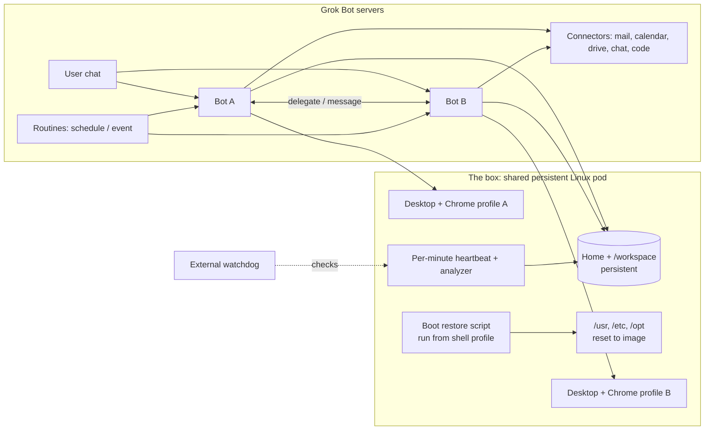

# Grok Bot Architecture

> Also available as a Google Doc; the GitHub markdown is the source of truth.

This document describes how Grok Bots run and the operating patterns that follow from it. For usage, see [`../tool-usages/grok-bot-getting-started.md`](../tool-usages/grok-bot-getting-started.md).

## Overview

- **Bots and chat** run on Grok Bot's hosted servers: conversations, memory, routines, and connectors live there.
- **The box** is one persistent Linux VM per user, **shared by all of that user's bots**. They share its filesystem, installed tools, and browser logins.
- **Desktops are per bot**: each bot gets its own desktop and its own Chrome profile/window (a separate profile directory under the home directory). A bot drives one browser session at a time.

## The Box Runtime

The box is a **container-style pod**: it runs under a minimal init (`tini`), with **no systemd and no cron**. Do not rely on system services or system crontabs.

### What persists

| Location | Survives restart / "Update Bot's Computer" |
|---|---|
| Home directory | Yes |
| `/workspace` | Yes |
| `/usr`, `/etc`, `/opt` | No, reset to the image |
| apt / system package installs | No, reset to the image |

### Install pattern

- Prefer **user-level installs**: `~/.local/bin`, a user npm prefix, `pip install --user`, language version managers under home.
- For anything that must live in system paths, keep a **boot restore script** in the home directory and run it from the shell profile (guarded so it runs once per boot and is idempotent).
- Record what the restore script does so any bot can re-run it.

### Browser extensions

Do not install extensions by hand per profile; they drift and some locations reset. Instead, **force-install them via Chrome managed policy**, written by the boot restore script, so every bot profile gets the same extensions after each restart.

## Monitoring

The box cannot report its own outage, so monitoring has two halves:

1. **Heartbeat (inside the box)**: a per-minute loop (started by the boot script, since there is no cron) writes a timestamped heartbeat with basic health (disk, memory, key processes).
2. **Analyzer (inside the box)**: periodically reviews heartbeat history for gaps, resource pressure, and failed restores, and summarizes findings for a bot routine.
3. **External watchdog (outside the box)**: an independent check (e.g. a hosted routine or external uptime service) alerts when heartbeats stop arriving.

## Bootstrapping A Swarm

The [swarm deploy agent](../tool-usages/grok-bot-swarm-deploy-agent.md) runs as an ordinary bot. It creates other bots on the hosted service, attaches generic skills, and records each action in a reviewable log, which can be kept in the home directory or `/workspace` on the box so every bot can read it. It is rate-limited and never creates accounts or spends money without the owner's approval.

## Design Rules

- Treat system paths as ephemeral; treat home and `/workspace` as the source of truth.
- Keep restore steps idempotent and fast.
- Bots share files, so use clear per-task directories and avoid clobbering each other's work.
- Keep secrets out of the shared filesystem where possible; follow [`../tool-usages/secure-secret-management.md`](../tool-usages/secure-secret-management.md).
