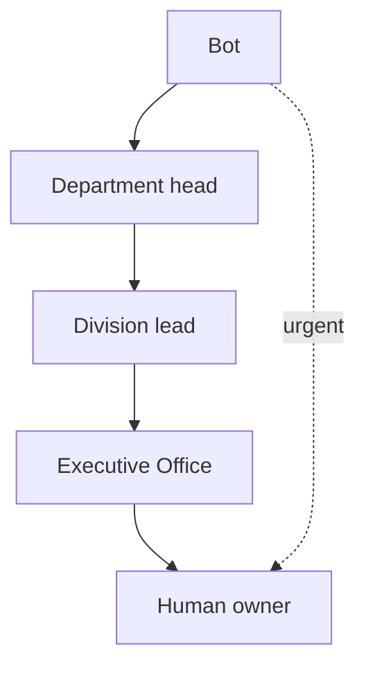

# Grok Bot: Setting Up An Organization Board

When you run more than a few Grok Bots, give them an **organization board**: a map of divisions and departments where every bot has one seat, one owner, and one clear route for work and escalation. This guide is a generic template. Rename divisions and departments to fit your organization.

See also: [`grok-bot-getting-started.md`](grok-bot-getting-started.md) and [`../architecture/grok-bot-architecture.md`](../architecture/grok-bot-architecture.md).

## 1. The Board Layout

Group work into **divisions**, each with a few **departments**. Each department has a head (a bot or a person), and each division has a lead. Example layout:

| Division | Example departments |
|---|---|
| 1. People and Communications | Personnel, Internal communications, Inspections |
| 2. Sales and Marketing | Marketing, Publications, Sales |
| 3. Finance | Income, Payables, Accounts and admin |
| 4. Delivery | Service delivery, Projects, Support |
| 5. Quality | Review, Training, Improvement |
| 6. Public and Partners | Public relations, Partnerships, Community |
| 7. Executive | **Executive Office**, Legal and compliance, Knowledge and analysis |

### Source of truth

Keep the board in one shared, access-controlled sheet or document. For each bot record: name, division, department, purpose, systems it may touch, owner (human), and status. Do not publish this sheet.

## 2. Executive Office: The Routing Hub

The Executive Office bot is the central coordinator. It:

- routes requests to bots by role
- assigns work to one bot at a time
- receives results and rolls up status
- decides what reaches the human owner directly and what stays in the hub

**Straight to the human owner:** draft cards awaiting Send, sign-ins and approvals only a human can do, urgent alerts.

**Through the hub:** status updates and summaries, handoffs between bots or departments, results of scheduled watches.

### Escalation path

1. Bot attempts the task.
2. Department head.
3. Division lead.
4. Executive Office.
5. Human owner (final). **Urgent items go directly to the human owner.**

Human approval is always required for money, external or customer-facing sends, and legal commitments.



## 3. Bot Intake And Approval

New bots are added through intake, never ad hoc. An intake entry records:

- bot name and builder
- proposed division and department
- purpose
- what it can touch (data, systems, connectors)
- whether it sends messages (default: draft-only)
- overlaps with existing bots

Approval flow:

1. Builder submits the intake entry.
2. Executive Office checks for conflicts and overlaps.
3. Human owner approves.
4. Bot is placed on the board.
5. Bot registers with Executive Office by message.

## 4. Handoff Message Format

Every handoff uses a fixed template:

```text
Task:          <what needs to be done>
Context:       <background and pointers to files or records>
Deadline:      <when the result is needed>
Prohibitions:  <what the bot must NOT do, e.g. no sends, no spending>
Report back:   <where to send the result, usually Executive Office>
```

Communication model: asynchronous, fire-and-forget messages; work routes through Executive Office; bots contact the human owner only when instructed or when something is urgent.

## 5. Shared Rules For All Bots

Put these in one shared skill that every bot loads:

- **Draft before external sends**: no email, chat, or post goes out without human approval.
- **Approval for risky actions**: deleting, sharing, spending, production changes.
- **One owner bot per external system**: a single bot polls and writes to each external service, which avoids rate limits and conflicting writes; others ask that bot.
- **Roll-up status**: bots report to their department head; status rolls up to Executive Office.
- **Secrets never in chat or repos**: fetch credentials from a vault at run time.
- **Escalate when uncertain**: follow the escalation path rather than guessing.
- **Respect prohibitions** in the handoff message; log what you did.

## 6. Getting Started

1. Draft your divisions and departments using the table above.
2. Create the Executive Office bot first, with the routing and escalation rules.
3. Write the shared-rules skill and attach it to every bot.
4. Set up the private board sheet and intake form.
5. Move existing bots through intake and give each one seat.
6. Assign an owner bot to each external system.
7. Add a daily roll-up routine on Executive Office and review it weekly.
