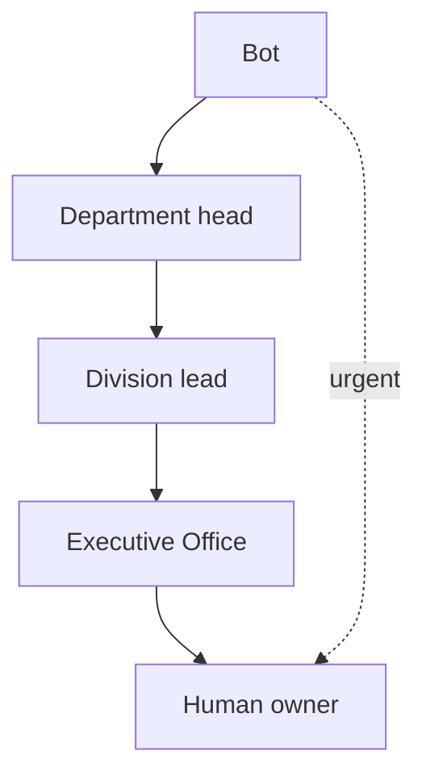

# Grok Bot: Setting Up An Organization Chart For A Bot Team

> Also available as a Google Doc; the GitHub markdown is the source of truth.

This chart is the **completeness list of functions a company must have covered** so a Grok Bot swarm can run operations. It is not software in this repository. You run the swarm on **xAI's hosted Grok Bot product**.

Use it in two ways:

- **Existing company:** keep their division and department names. Map each seat onto a function in the table. Any function with no seat is a gap: fill it with a bot, a human, or both.
- **Company that does not yet have a chart:** use the table as the starting organization. Names are placeholders; rename them to match the business.

A seat may be a bot, a human, or a mix (human owner with a bot doing the daily work). Combined seats are fine. **Empty functions are not.**

See also: [`grok-bot-getting-started.md`](grok-bot-getting-started.md) and [`../architecture/grok-bot-architecture.md`](../architecture/grok-bot-architecture.md).

## Introduction

Each Grok Bot needs a clearly defined role, a single human owner, and a route for escalation. The table lists seven divisions and twenty-one departments as the functions that must be populated for the swarm to cover company operations.

Deploy this in practice with the [swarm deploy playbook](grok-bot-swarm-deploy-agent.md): give those instructions to a first hosted Grok Bot, answer size / industry / staffing questions, review the proposed chart (including how it maps onto any existing org chart), then approve creation.

## 1. Functions That Must Be Covered (Seven Divisions, Twenty-One Departments)

| Division | Department | What it does |
|---|---|---|
| **1. People and Communications** | 1. Human Resources | Recruiting, onboarding, offboarding, personnel records |
| | 2. Internal Communications | Routing of internal mail and messages, announcements, scheduling |
| | 3. Performance and Compliance Review | Checks that work is done to standard and policies are followed |
| **2. Marketing and Sales** | 4. Marketing | Campaigns, market research, promotion planning |
| | 5. Publications | Website, content, brochures, newsletters |
| | 6. Sales | Lead handling, proposals, closing, renewals |
| **3. Finance** | 7. Revenue and Billing | Invoicing, collections, payment reconciliation |
| | 8. Payables | Vendor bills, expenses, payroll processing |
| | 9. Accounting and Assets | Bookkeeping, reporting, budgets, equipment and supplies |
| **4. Operations and Delivery** | 10. Service Planning | Capacity, scheduling, resource allocation |
| | 11. Service Delivery | Producing the product or service for customers |
| | 12. Delivery Tracking | Measuring output, deadlines, and delivery metrics |
| **5. Quality and Training** | 13. Quality Assurance | Reviewing output and correcting defects |
| | 14. Training | Staff training, documentation, standard operating procedures |
| | 15. Process Improvement | Root-cause analysis and refinement of procedures |
| **6. Customers and Partners** | 16. Customer Success | Account care, support escalations, satisfaction |
| | 17. Partnerships | Vendors, resellers, alliances |
| | 18. Public Relations and Community | Reputation, events, public presence |
| **7. Executive** | 19. Executive Office | Coordination, routing, and oversight of all divisions |
| | 20. Legal and Risk | Contracts, compliance, insurance, risk management |
| | 21. Strategy and Analysis | Planning, reporting, knowledge management |

The deploy playbook may combine departments onto one bot in a small company, and split them as volume grows. Combined is still covered. Each department has a head (a bot, a person, or a person with a bot), and each division has a lead.

### Source of truth

Keep the board in one shared, access-controlled sheet or document. For each bot record: name, division, department, purpose, systems it may touch, owner (human), and status. Do not publish this sheet.

## 2. Executive Office: The Routing Hub

The Executive Office bot is the central coordinator. It:

- routes requests to bots by role
- assigns work to one bot at a time
- receives results and rolls up status
- decides what reaches the human owner directly and what stays in the hub

**Straight to the human owner:** draft cards awaiting Send, sign-ins and approvals only a human can do, urgent alerts.

**Through the hub:** status updates and summaries, handoffs between bots or departments, results of scheduled watches.

### Escalation path

1. Bot attempts the task.
2. Department head.
3. Division lead.
4. Executive Office.
5. Human owner (final). **Urgent items go directly to the human owner.**

Human approval is always required for money, external or customer-facing sends, and legal commitments.



## 3. Bot Intake And Approval

New bots are added through intake, never ad hoc. An intake entry records:

- bot name and builder
- proposed division and department
- purpose
- what it can touch (data, systems, connectors)
- whether it sends messages (default: draft-only)
- overlaps with existing bots

Approval flow:

1. Builder submits the intake entry.
2. Executive Office checks for conflicts and overlaps.
3. Human owner approves.
4. Bot is placed on the board.
5. Bot registers with Executive Office by message.

## 4. Handoff Message Format

Every handoff uses a fixed template:

```text
Task:          <what needs to be done>
Context:       <background and pointers to files or records>
Deadline:      <when the result is needed>
Prohibitions:  <what the bot must NOT do, e.g. no sends, no spending>
Report back:   <where to send the result, usually Executive Office>
```

Communication model: asynchronous, fire-and-forget messages; work routes through Executive Office; bots contact the human owner only when instructed or when something is urgent.

## 5. Shared Rules For All Bots

Put these in one shared skill that every bot loads:

- **Draft before external sends**: no email, chat, or post goes out without human approval.
- **Approval for risky actions**: deleting, sharing, spending, production changes.
- **One owner bot per external system**: a single bot polls and writes to each external service, which avoids rate limits and conflicting writes; others ask that bot.
- **Roll-up status**: bots report to their department head; status rolls up to Executive Office.
- **Secrets never in chat or repos**: fetch credentials from a vault at run time.
- **Escalate when uncertain**: follow the escalation path rather than guessing.
- **Respect prohibitions** in the handoff message; log what you did.

## 6. Getting Started

The [swarm deploy playbook](grok-bot-swarm-deploy-agent.md) can perform most of these steps for you, with owner approval. To do it by hand:

1. Draft your divisions and departments using the table above.
2. Create the Executive Office bot first, with the routing and escalation rules.
3. Write the shared-rules skill and attach it to every bot.
4. Set up the private board sheet and intake form.
5. Move existing bots through intake and give each one seat.
6. Assign an owner bot to each external system.
7. Add a daily roll-up routine on Executive Office and review it weekly.
