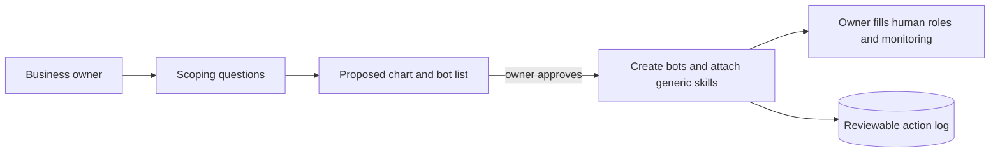

# Grok Bot Swarm Deploy Agent

> Also available as a Google Doc; the GitHub markdown is the source of truth.

The **swarm deploy agent** is a one-step way to start a company's Grok Bot team. You point a fresh Grok Bot installation at the deploy agent. It creates the bots you need, fills in the organization chart and related charts, and gives each bot a starter set of skills, so the company starts with a working team on day one.

See also: [`grok-bot-getting-started.md`](grok-bot-getting-started.md), [`grok-bot-org-board-guide.md`](grok-bot-org-board-guide.md), and [`../architecture/grok-bot-architecture.md`](../architecture/grok-bot-architecture.md).

## 1. The One-Step Bootstrap

1. Install Grok Bot and create a first bot.
2. Point it at the swarm deploy agent (for example, by loading the deploy agent's instructions and skills).
3. Answer its scoping questions (Section 2).
4. Review and approve its proposed organization chart and bot list.
5. The deploy agent creates the bots, places each one on the chart, and attaches the starter skills.
6. The business owner fills in the human roles. At first, the owner can take on all of the monitoring roles personally and hand them to staff as the company grows.

## 2. Scoping Before Generation

The deploy agent does not apply one fixed template. It first asks two or three questions:

- **Company size**: how many people today, and expected in a year?
- **Industry**: what the company sells and how it delivers it.
- **People**: are there human staff yet, or is the owner working alone?

It then generates a tailored chart. The seven-division, twenty-one-department structure in the [organization chart guide](grok-bot-org-board-guide.md) is a **reference model** that the agent scales down or up:

| Company profile | Typical result |
|---|---|
| Solo owner, no staff | 3 combined divisions (e.g. Growth, Delivery, Administration) with one bot each; the owner holds every head and monitoring role |
| Small team (2 to 20 people) | 4 or 5 divisions, several departments combined per bot |
| Established company | The full seven divisions and twenty-one departments, one bot per department or more |

## 3. Generic Starter Skills

Starter kits ship only **generic** skills, for example:

- how to route a task to the right bot
- how to hand off work using the standard message format
- how to roll up status to a department head and the Executive Office
- how to draft, rather than send, external messages
- how to escalate when uncertain

Starter kits contain no company-specific operating methods. Each deployment adds its own domain skills (its products, procedures, and tone) after bootstrap.

## 4. Optional Recruitment Suggestions (Division 1)

The People and Communications division can optionally enable a **suggestions module** that lists example partners for hiring, such as:

- *Example:* an HR services firm
- *Example:* a recruiting agency
- *Example:* a job board

These are placeholder examples, not endorsements, and the module is not a built-in dependency. The owner chooses whether to use it and which partners, if any, to add.

## 5. Safety

- **Rate-limited**: the deploy agent creates bots and changes in small, paced batches.
- **No autonomous accounts or spending**: it never creates external accounts, signs up for services, or spends money on its own; it always asks the owner.
- **Owner approval** for the chart, the bot list, and any connector it proposes.
- **Reviewable log from day one**: every action (bot created, skill attached, chart updated, question asked) is written to a log the owner can inspect at any time.
- All bots it creates inherit the shared rules: draft before external sends, approval for risky actions.
